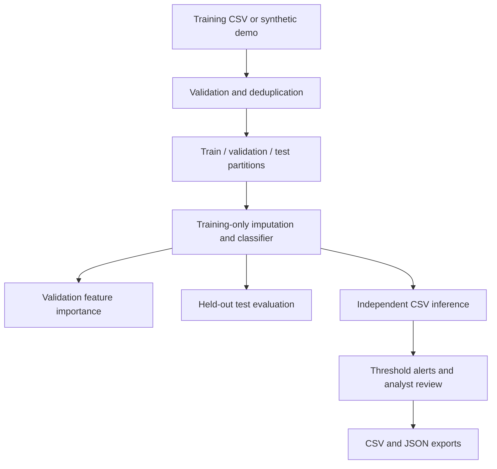

# SentinelIDS — AI Network Intrusion Detection

[](https://github.com/asif3252/SentinelIDS/actions/workflows/tests.yml)


[](LICENSE)

**Turn network-flow CSVs into inspectable predictions, reviewable alerts and transparent model evaluation.**

Built and maintained by [Dr. Muhammad Asif](https://github.com/asif3252), SentinelIDS brings classical machine learning and an interactive analyst interface into a compact cybersecurity project. It supports normal-traffic, denial-of-service and port-scan classes within its documented feature schema.

> **Project status:** Working local prototype confirmed by the project owner. The default data is synthetic; demo metrics do not establish real-world detection performance. This release performs offline flow analysis.

**[Quick start](#quick-start-windows-powershell)** · **[CSV schema](#csv-contract)** · **[Architecture](docs/ARCHITECTURE.md)** · **[Validation](VALIDATION.md)** · **[Roadmap](docs/ROADMAP.md)**

An offline AI network-flow intrusion detection workbench built with Python, scikit-learn, Streamlit and Plotly. Intended for a reproducible cybersecurity portfolio and experimentation.

## Why this project

An intrusion detector needs more than a class label. Analysts need to understand the input contract, distinguish a classification from a threshold alert, inspect evaluation errors and export evidence for review. SentinelIDS makes those steps visible in one local application, with explicit boundaries around synthetic data, model confidence and operational readiness.

## Capabilities at a glance

| Area | Implemented behavior |
|---|---|
| Training | Random Forest and Extra Trees; synthetic demo or labeled CSV |
| Evaluation | Reserved test partition; precision, recall, F1 and confusion matrix |
| Interpretation | Global validation permutation importance |
| Investigation | Flow inspection, adjustable alert threshold and priority cues |
| Exports | Prediction CSV, evaluation JSON and schema example |
| Engineering | Input validation, unit tests and GitHub Actions workflow |

## Clone the repository

```powershell
git clone https://github.com/asif3252/SentinelIDS.git
cd SentinelIDS
```

## Quick start (Windows PowerShell)

Install Python 3.11 or 3.12, then open PowerShell in this folder:

```powershell
py -3.11 -m venv .venv
.\.venv\Scripts\python.exe -m pip install -r requirements.txt
.\.venv\Scripts\python.exe -m unittest discover -s tests -v
.\.venv\Scripts\python.exe -m streamlit run app.py --server.address 127.0.0.1
```

If using Python 3.12, replace `-3.11` with `-3.12`. Open the local URL printed by Streamlit. No account, cloud service or API key is required. Dependencies require internet access during installation.

### Linux / macOS

```bash
python3 -m venv .venv
.venv/bin/python -m pip install -r requirements.txt
.venv/bin/python -m unittest discover -s tests -v
.venv/bin/python -m streamlit run app.py --server.address 127.0.0.1
```

### First analysis

1. Open `http://localhost:8501` and keep **Synthetic demo** selected.
2. Choose a classifier and inspect its test metrics.
3. Explore **Traffic analysis**, **Model explanation** and **Evaluation**.
4. Adjust the threshold to change binary alerts; the multiclass test metrics remain fixed.
5. Export predictions or upload an independent CSV matching the schema below.

To stop the server, press `Ctrl+C`. To restart, run the Streamlit command again from the repository folder.

## Features

- Synthetic demonstration dataset and custom labeled CSV training.
- Random Forest and Extra Trees classifiers.
- Stratified 60/20/20 training/validation/test partitions, with median imputation fitted only on training rows.
- Held-out class precision, recall, F1, confusion matrix and benign false-positive rate.
- Validation permutation importance for global model inspection.
- Adjustable alert threshold, individual flow inspection, prediction CSV and evaluation JSON exports.
- Input validation; no uploaded executable models or pickle deserialization.

## CSV contract

One row represents one aggregated network flow. Header spelling and units must match:

| Column | Meaning |
|---|---|
| duration_s | Flow duration in seconds |
| packets | Total packet count |
| bytes | Total flow bytes |
| syn_count | Number of TCP SYN flags |
| rst_count | Number of TCP RST flags |
| destination_port | Destination port, 0–65535 |
| mean_packet_size | Mean packet size in bytes |
| interarrival_ms | Mean packet interarrival time in milliseconds |
| label | Training only: BENIGN, DOS, PORT_SCAN |

All features must be numeric and nonnegative. Blank values are median-imputed; entirely blank feature columns and infinities are rejected. At least ten rows per class are required for training. Extra columns are excluded from training. Upload limit: 20 MB and 100,000 rows. Export an example from the sidebar.

## Architecture



Read the [architecture and methodology](docs/ARCHITECTURE.md) for split logic, model configuration, metric definitions and explanation limits.

## Repository layout

| Path | Purpose |
|---|---|
| `app.py` | Dashboard and analyst workflow |
| `sentinel.py` | Data generation, validation, training and prediction |
| `requirements.txt` | Bounded dependency ranges |
| `tests/` | Automated pipeline checks |
| `.github/workflows/` | Continuous integration |
| `docs/` | Architecture, roadmap and development guidance |
| `SECURITY.md` | Reporting and deployment boundaries |
| `VALIDATION.md` | Actual checks performed and remaining limitations |

## Interpretation and limitations

The bundled traffic is generated from artificial overlapping distributions, not packet captures. Demo scores only establish that the software pipeline runs. They must not be presented as benchmark results, published attack detection evidence, or proof of production readiness. Attack names describe simulated classes; the model does not identify specific vulnerabilities or inspect packet payloads.

The alert score is `1 - P(BENIGN)`. Scores are not calibrated probabilities. The threshold controls binary alerts while the predicted class uses argmax; these can disagree. Priority is a score-based review aid, not a validated severity assessment. Dashboard test metrics describe argmax classification and do not change with the threshold. Global permutation importance does not explain individual decisions.

For real experiments, obtain a permitted labeled dataset, implement and document a unit-correct mapping to this schema, and verify labels. CICIDS/UNSW datasets are not directly compatible with these headers. Do not fabricate missing flags or silently assume equivalent units. Split by capture session, host or time before fitting to reduce leakage; a random row split does not establish generalization across captures. Exact duplicates are removed, but correlated flows and conflicting labels still need an analyst's review. Keep a final external test set untouched, select models and thresholds using validation data, and report per-class metrics, prevalence, confidence intervals and drift. Repeated dashboard model comparisons expose test results; do final model selection in a separate controlled experiment.

This version does not capture live traffic, block attacks, support arbitrary attack labels, persist models or provide production authentication. Run locally. CSV contents remain in the local process; do not expose the server publicly or commit private traffic.

## Tests

`python -m unittest discover -s tests -v` checks held-out sample accounting, prediction scores, threshold monotonicity and invalid-input rejection. Dependencies use bounded ranges; freeze your tested environment for reproducible research.

## Development and future updates

After editing a local clone, review the changes before committing:

```powershell
git status
git diff
python -m unittest discover -s tests -v
git add .
git commit -m "Describe the specific improvement"
git push origin main
```

Use `.\.venv\Scripts\python.exe` instead of `python` on Windows when the environment is not activated. Never commit `.venv`, credentials or private traffic. See [CONTRIBUTING.md](CONTRIBUTING.md) for the contribution workflow.

## Troubleshooting

| Symptom | Action |
|---|---|
| Python is not found | Install Python 3.11/3.12 and reopen the terminal |
| A module is missing | Install requirements using the same environment's Python |
| Port 8501 is occupied | Add `--server.port 8502` to the launch command |
| CSV headers are rejected | Compare the exact spelling and units with the schema |
| Training labels are rejected | Supply all three supported labels with at least ten distinct rows per class |
| First launch is slow | Training and permutation importance run before the dashboard is ready |

## Contributing and security

Use [bug reports](https://github.com/asif3252/SentinelIDS/issues) for reproducible, non-sensitive problems. Read the [security policy](SECURITY.md) before sharing vulnerability information or deploying beyond localhost. Planned capabilities are listed separately in the [roadmap](docs/ROADMAP.md).

## Primary documentation

- https://scikit-learn.org/stable/modules/generated/sklearn.ensemble.RandomForestClassifier.html
- https://scikit-learn.org/stable/modules/generated/sklearn.inspection.permutation_importance.html

License: MIT; see LICENSE.
