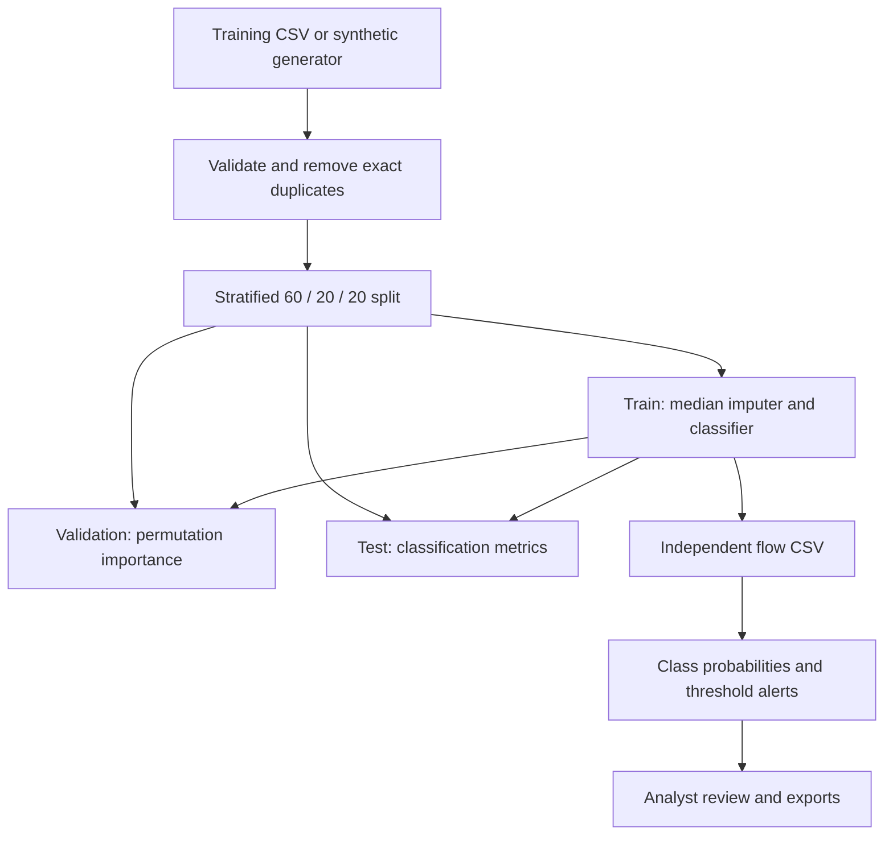

# Architecture and detection methodology

## Components

| Component | Responsibility |
|---|---|
| `app.py` | Streamlit interface, bounded uploads, model caching and exports |
| `sentinel.py` | Schema validation, synthetic generator, training, evaluation and inference |
| `tests/test_pipeline.py` | Pipeline accounting, probability checks, threshold monotonicity and invalid input tests |
| `.github/workflows/tests.yml` | Automated test execution on pushes and pull requests |

## Data flow

## Training

Rows are deduplicated using the eight feature columns plus the label. A stratified 80/20 split reserves the test partition. A second split divides the development partition into training and validation, giving approximately 60/20/20 overall. Small datasets can differ by a row because of rounding. Fixed random seeds make a given compatible environment repeatable.

The fitted pipeline imputes missing features using training medians, then fits either Random Forest or Extra Trees. Both use 120 trees, maximum depth 14, minimum leaf size 2 and balanced class weights. The label is excluded from input features. The current version does not tune hyperparameters automatically.

## Classification and alerting

The multiclass prediction is the class with maximum estimated probability among BENIGN, DOS and PORT_SCAN. The binary attack score is the sum of non-benign class probabilities, computed as `1 - P(BENIGN)`. An alert is emitted when this score meets the selected threshold. A class prediction and a binary alert may therefore disagree.

Priority is High for scores at least 0.85, Review for other threshold alerts and Low otherwise. Priority is a simple investigation cue, not a validated incident-severity model. At thresholds above 0.85, a High-priority flow may fall below the chosen alert threshold.

## Evaluation

The report uses highest-probability class predictions on the reserved test partition. Binary attack recall combines both attack classes; confusing DOS with PORT_SCAN still counts as detecting attack traffic. The false-positive rate is the proportion of BENIGN test flows classified as either attack category. Macro F1 gives equal weight to all three classes. These metrics are independent of the threshold slider.

Permutation importance measures the decrease in validation macro F1 when each feature is shuffled, averaged over three repeats. It describes global reliance of the trained model. Correlated features and unstable samples can affect the values. It is neither causal evidence nor a local explanation for a specific alert.

## Research boundaries

Random row splits can leak capture-specific information through correlated flows. Real studies should reserve capture sessions, hosts or time periods before fitting. External datasets need explicit adapters; similar column names alone do not establish equivalent units or semantics. Keep an external final test set for the selected model because repeated dashboard comparisons reveal test results. Unknown attack categories, concept drift, model calibration, live flow extraction and operational false-positive burden remain future work.
